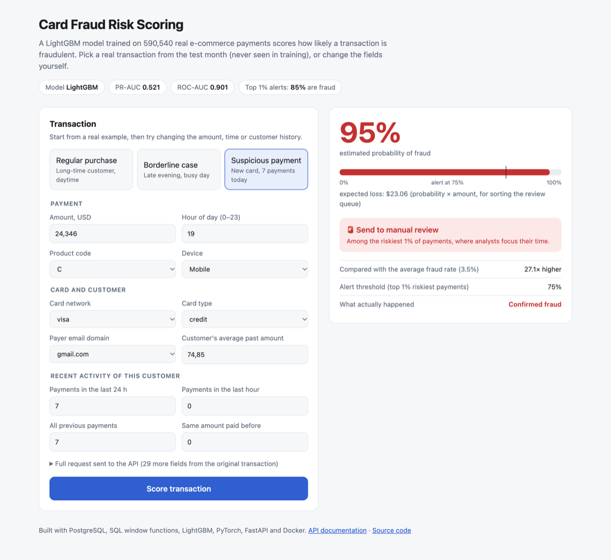
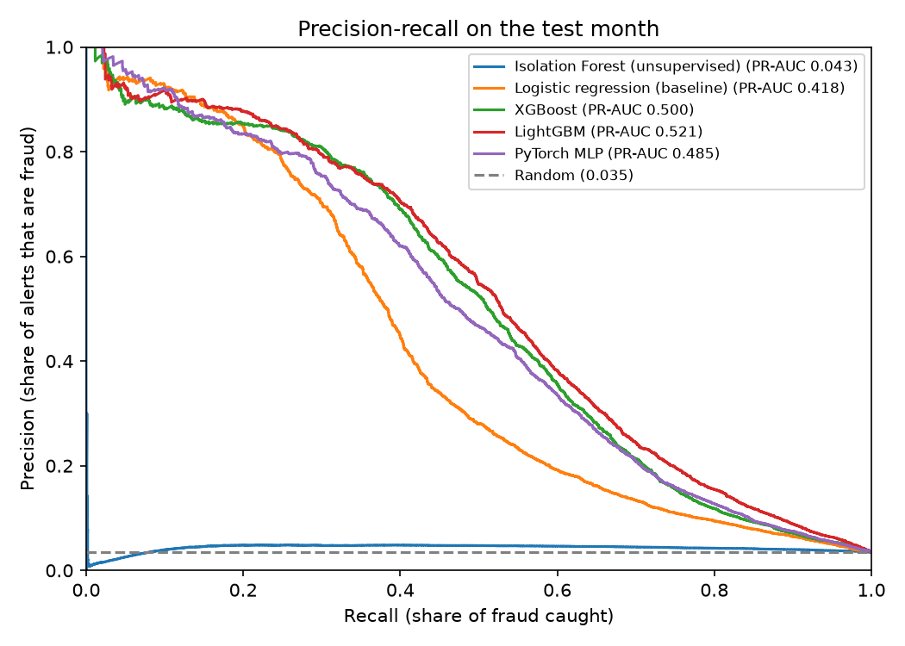
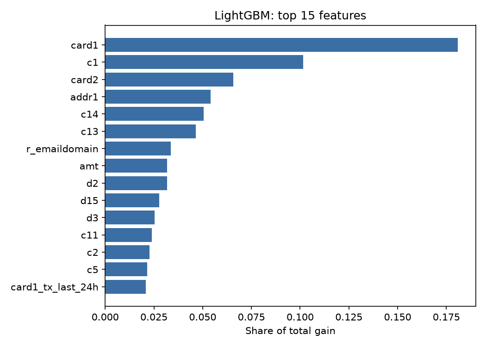

# Fraud Detection Pipeline: PostgreSQL → Feature Engineering → LightGBM vs PyTorch → Docker API

End-to-end machine-learning pipeline that flags fraudulent card transactions in
**590,540 real e-commerce payments** (IEEE-CIS / Vesta dataset, 3.5% fraud).
Raw data is loaded into PostgreSQL, behavioural features are built with SQL
window functions, gradient boosting is compared against a hand-written PyTorch
network, the numbers are stress-tested (seeds, bootstrap, dollars), and the best
model is served as a containerised REST API.

**▶ Live demo: [fraud-risk-demo.onrender.com](https://fraud-risk-demo.onrender.com)**: score real transactions in the browser (free hosting: the first request after a pause can take up to a minute while the service wakes up).

| | |
|---|---|
| **Best model** | LightGBM: **PR-AUC 0.515 ± 0.003** over 5 seeds (ROC-AUC 0.90) on a held-out future month |
| **Business view** | Reviewing the top 1% riskiest transactions catches **24% of fraud cases** at **85% precision**, but only **15% of fraud dollars** |
| **Money-first ranking** | Sorting the same review queue by expected loss (probability × amount) catches **36% of fraud dollars** ($171k vs $72k) |
| **Stack** | PostgreSQL · SQL window functions · pandas · XGBoost · LightGBM · PyTorch · FastAPI · Docker · pytest |



*Interactive demo served by the same container at `/`: pick a real transaction from the test month or edit the fields, and the API returns the fraud probability, the expected loss and a review decision.*

**Skills shown:** SQL data modelling and window functions · leakage-free feature engineering ·
imbalanced classification · time-based validation · uncertainty (seeds, day-level bootstrap) ·
cost-aware evaluation · PyTorch (`nn.Module`, embeddings, manual training loop) · REST API
design · Docker · automated tests incl. training/serving parity.

---

## Results

Trained on months 1–4, early-stopped on month 5 (validation), reported on month 6 (test, never
seen during training or tuning).

| Model | PR-AUC | PR-AUC 95% CI | ROC-AUC | Recall @ 1% alerts | Precision @ 1% alerts | Precision | Recall | F1 |
|---|---|---|---|---|---|---|---|---|
| Logistic regression (baseline) | 0.4179 | 0.378–0.460 | 0.8499 | 23.15% | 80.65% | 50.36% | 37.99% | 0.4331 |
| XGBoost | 0.5004 | 0.464–0.539 | 0.8815 | 24.25% | 84.45% | 57.28% | 46.34% | 0.5123 |
| **LightGBM** | **0.5208** | 0.482–0.558 | **0.9008** | **24.34%** | **84.79%** | 56.33% | **49.58%** | **0.5274** |
| PyTorch MLP (embeddings) | 0.4847 | 0.442–0.527 | 0.8820 | 23.51% | 81.88% | 56.77% | 43.22% | 0.4908 |
| Isolation Forest (unsupervised) | 0.0433 | 0.038–0.051 | 0.5988 | 0.35% | 1.21% | 4.47% | 13.94% | 0.0677 |

Precision, recall and F1 are measured at each model's max-F1 threshold, chosen on the
validation month (thresholds in [`reports/model_comparison.md`](reports/model_comparison.md)).
The 95% interval comes from resampling whole test days ([`reports/robustness.md`](reports/robustness.md)).
Random guessing gives PR-AUC ≈ 0.035 (the fraud rate).



**Takeaways**
- **Gradient boosting wins on tabular data**, as it usually does: trees handle missing
  values, skewed amounts and high-cardinality IDs natively. The neural net needs
  log transforms, scaling, missing-value flags and embeddings to get close.
- **But one month cannot rank the top models precisely.** The 95% intervals of LightGBM,
  XGBoost and the MLP overlap. LightGBM vs the logistic-regression baseline is a real gap.
- **Why PR-AUC, not accuracy:** a model that never predicts fraud is 96.5% accurate.
  PR-AUC measures how well fraud is ranked above legitimate payments without flooding
  analysts with false alarms.
- **Why a time split:** fraud patterns drift (weekly fraud rate varies from 1.9% to 5.1%).
  A random split would let the model learn from the future and overstate quality.



### How much can these numbers be trusted?

[`src/robustness.py`](src/robustness.py) checks the headline numbers instead of taking one run at face value.

- **Random seed.** LightGBM retrained with 5 seeds: test PR-AUC **0.5149 ± 0.0031**
  (0.5124–0.5189). The table above uses seed 42, which happens to be the best run
  (0.5208), so the honest headline is **0.515**.
- **Day-level bootstrap.** Resampling whole test days (fraud comes in campaigns, so single
  rows are not independent) gives a 95% interval of 0.48–0.56 for LightGBM. Differences of
  0.01–0.02 between the top models are within this noise.
- **Ensemble, decided on validation.** A rank average of LightGBM, XGBoost and the MLP is
  slightly better on the validation month (PR-AUC 0.5924 vs 0.5868), so by the protocol it
  qualifies. On the test month it is slightly worse (0.5190 vs 0.5208). Both differences are
  about the size of the seed noise, so the API keeps the single LightGBM model: simpler to
  serve, no measurable loss.

### What the model catches in dollars

The fraud team cares about money, not case counts. In the test month there is **$477k** of
fraud. With the same budget (review 1% of transactions), the ranking rule makes a large
difference ([`reports/alert_ranking.md`](reports/alert_ranking.md)):

| Review the top 1% by | Month | Fraud cases caught | Reviewed cases that are fraud | Fraud dollars caught |
|---|---|---|---|---|
| fraud probability (API alert rule) | validation | 26.0% | 87.9% | 17.7% ($79.6k) |
| expected loss = probability × amount | validation | 17.7% | 59.9% | **41.5% ($187.0k)** |
| fraud probability (API alert rule) | test | 24.3% | 84.8% | 15.1% ($71.9k) |
| expected loss = probability × amount | test | 14.6% | 50.9% | **35.9% ($171.3k)** |

- Ranking by probability finds many **small** frauds (card testing) with high precision, but
  most of the stolen money is in larger payments it ranks lower.
- Ranking by **expected loss** more than doubles the dollars caught, on validation and on
  test alike. The cost: half of the reviewed cases are legitimate large purchases.
- Which rule is right is a business decision (cost of a review vs value of the money). The
  API returns both: `fraud_probability` and `expected_loss_usd` for sorting the review queue.

### Decision threshold

A model outputs a probability; the business needs a yes/no decision. The threshold is
**always chosen on the validation month** and then applied unchanged to the test month.

- **API threshold: 0.748 (LightGBM)**, the score above which the top **1%** of validation
  transactions fall. This is an *alert-budget* rule: a fraud team can only review so many
  cases a day, so the threshold is set by capacity, not by a generic default like 0.5 (with
  3.5% fraud, a 0.5 cut-off would be arbitrary). On the test month it flags 0.99% of
  transactions, catches 24.18% of all fraud, and 84.89% of alerts are real fraud
  (F1 0.3764). Stored in `models/api_config.json`.
- **Max-F1 threshold per model**, the point that balances precision and recall. It flags
  more transactions (higher recall, lower precision); it is the right choice if automatic
  actions (e.g. 3-D Secure step-up) are cheap.
- `reports/api_threshold_test.json`: precision / recall / F1 of the API threshold on the test month.

### Which features are worth serving?

The served model uses 45 features: those a real-time system can supply cheaply plus the SQL
behaviour features. The Kaggle files have ~430 columns, most of them Vesta's anonymised
engineered features (V1–V339). [`src/feature_ablation.py`](src/feature_ablation.py) measures
what leaving them out costs, on the same split:

| Feature set | Features | PR-AUC | ROC-AUC | Recall @ 1% | Precision @ 1% |
|---|---|---|---|---|---|
| **base (served model)** | 45 | 0.5208 | 0.9008 | 24.34% | 84.79% |
| + C/D/M counters, time deltas, match flags | 66 | 0.5248 | 0.9013 | 24.28% | 84.56% |
| + V1–V339 (Vesta features) | 405 | **0.5458** | **0.9038** | **25.50%** | **88.81%** |
| + identity (device, browser, network) | 445 | 0.5410 | 0.9033 | 25.27% | 88.03% |

- The V columns add **+0.025 PR-AUC**, about 8× the seed noise, so it is a real gain.
- Identity columns add nothing on top.
- The API stays on 45 features: an endpoint that needs 339 anonymised columns per request is
  hard to integrate and cannot be explained to the analysts who use it. If Vesta's feature
  service is available in production, the V set is the first upgrade.

### Unsupervised baseline: Isolation Forest

`src/train_iforest.py` fits an **Isolation Forest without labels** (`contamination` = fraud
rate in train). Random trees split on random features at random values; an outlier gets
isolated in **few splits**, so a **short average path = anomaly**. It shows how far
"unusual" gets us when labels are late or missing (chargebacks arrive weeks later). Its
limit: fraud that imitates normal behaviour is not an outlier, so it should be expected to
trail the supervised models, which learn what fraud looks like from labels. It does:
PR-AUC 0.0433, barely above random (0.035), against 0.5208 for LightGBM.

---

## Pipeline

```
Kaggle CSVs ──COPY──> PostgreSQL raw.*  ──SQL window functions──> features.transactions
                                                                           │
                                                           Parquet export  │
                                                                           ▼
                       ┌───────────── time split: train | valid | test ─────────────┐
                       │  LogReg baseline · XGBoost · LightGBM · PyTorch MLP        │
                       │  Isolation Forest (no labels) · feature-set ablation        │
                       └────────────────────────────┬───────────────────────────────┘
                                                    │ seeds · day bootstrap · $ metrics
                                                    │ best model
                                                    ▼
                                  FastAPI /predict  ──>  Docker image
```

### 1. Data in PostgreSQL (`sql/`)
- `01_create_raw_tables.sql`: 394 + 41 column raw tables, generated from the CSV headers by `src/generate_raw_ddl.py`
- `02_load_raw.sql`: bulk load with `COPY` (735k rows in ~70 s)
- `03_data_quality.sql`: class balance, duplicates, missing values, fraud rate over time and by segment ([output](reports/data_quality.txt))

### 2. Feature engineering (`sql/04_features.sql`)
Every behavioural feature uses **only transactions before the current one**, exactly
what a real-time system knows when a payment arrives, so there is no target leakage.

| Feature | Fraud pattern it captures |
|---|---|
| `uid` = card1 + addr1 + card start day (`day − D1`) | Proxy customer ID (the dataset has none). This idea is not mine: it was popularised by the competition's 1st-place solution (Chris Deotte and Konstantin Yakovlev). What this project adds is computing the history features from it **only from past transactions**, in SQL |
| `uid_tx_last_1h`, `uid_tx_last_24h`, `card1_tx_last_24h` | **Velocity**: stolen cards are used fast, before they are blocked. 0 prior tx in 24 h → 2.4% fraud; 4+ → 7.7% |
| `amt_to_uid_mean`, `uid_prev_std_amt` | Amount unusual **for this customer** (raw amount barely separates classes) |
| `secs_since_prev_tx` | Bursts of rapid payments |
| `uid_same_amt_prev` | Repeated amounts look like subscriptions, i.e. legitimate |
| `amt_cents` | Odd cents (e.g. 49.817) mean currency conversion, i.e. a foreign merchant |
| `hour` | Night-time activity while the owner sleeps |
| `email_mismatch`, `has_identity` | Payer/recipient domain differ; device data present (7.9% vs 2.1% fraud) |

### 3. Models (`src/`)
- `preprocess.py`: time split; category vocabulary and scaling fitted on train only
- `train_gbm.py`: logistic regression baseline, XGBoost and LightGBM with native categorical support and early stopping
- `nn_model.py` / `train_nn.py`: **PyTorch from scratch**: custom `Dataset`, `nn.Module` with one embedding table per categorical column, hand-written training loop, `BCEWithLogitsLoss` with `pos_weight` for class imbalance, AdamW, early stopping on validation PR-AUC
- `train_iforest.py`: unsupervised Isolation Forest baseline (labels not used for training)
- `evaluate.py`: PR-AUC, ROC-AUC, recall/precision at a fixed 1% alert budget, and precision/recall/F1 at a decision threshold
- `compare.py`: one table for all models on the same test month; thresholds chosen on validation

### 4. Serving (`src/api/`, `docker/`)
- FastAPI service: `POST /predict` returns the fraud probability and an alert flag; `GET /health`
- Demo page at `/` (plain HTML + JavaScript, no extra framework) with three real test-month transactions: legitimate, borderline and fraud
- Alert threshold chosen on the validation month (top 1% of scores), not on test
- Slim Docker image with only inference dependencies, running as a non-root user
- Deployed on Render from `render.yaml` (infrastructure as code): Render builds `docker/Dockerfile` straight from this repo
- `tests/test_parity.py` checks that the API reproduces offline model scores on real
  transactions, guarding against training/serving skew

---

## Run it yourself

Requires Linux or WSL2, Docker and Python 3.12.

```bash
# 1. Data: accept the competition rules on Kaggle, then put the files in data/raw/
#    https://www.kaggle.com/competitions/ieee-fraud-detection/data

# 2. Database
cp .env.example .env
docker compose up -d
docker compose exec -T db psql -U fraud -d fraud -f /sql/01_create_raw_tables.sql
docker compose exec -T db psql -U fraud -d fraud -f /sql/02_load_raw.sql
docker compose exec -T db psql -U fraud -d fraud -f /sql/03_data_quality.sql
docker compose exec -T db psql -U fraud -d fraud -f /sql/04_features.sql

# 3. Python environment and training
bash scripts/setup_env.sh && source ~/.venvs/fraud/bin/activate
python -m src.build_dataset
python -m src.train_gbm
python -m src.train_nn
python -m src.train_iforest
python -m src.compare
python -m src.robustness        # seeds, bootstrap intervals, dollars, ensemble, alert ranking
python -m src.feature_ablation  # what the unused raw columns would add
python -m pytest tests

# 4. API in Docker
docker build -f docker/Dockerfile -t fraud-api .
docker run -p 8080:8080 fraud-api
# demo page: http://localhost:8080/   ·   API docs: http://localhost:8080/docs
```

Example request:

```bash
curl -X POST http://localhost:8080/predict -H "Content-Type: application/json" \
  -d '{"amt": 117.0, "hour": 3, "product_cd": "C", "card4": "visa", "card6": "credit", "uid_tx_last_24h": 6}'
```

## Limitations and next steps
- The API expects customer-history features in the request; in production they would come
  from a feature store or the PostgreSQL feature layer.
- One test month: the 95% interval of PR-AUC is about ±0.04, so small differences between
  the top models are not conclusive. A rolling evaluation over several months would be
  stronger, but the dataset covers only six.
- 45 of ~430 raw columns are served; the V columns would add +0.025 PR-AUC (see the feature
  ablation) if the production system can supply them.
- The model is trained to find fraud *cases*; ranking by expected loss is a post-hoc fix.
  Training with amount-weighted samples and choosing the rule with the fraud team's real
  review cost is the next step.
- Next: probability calibration, and monitoring of drift and alert volume after deployment.

## Project structure

```
├── sql/                  # schema, bulk load, data-quality checks, feature layer
├── src/                  # dataset export, preprocessing, models, evaluation
│   └── api/              # FastAPI inference service
├── docker/Dockerfile     # inference image
├── docker-compose.yml    # PostgreSQL for local development
├── tests/                # API tests and training/serving parity test
├── models/               # serving artifacts (LightGBM, preprocessor, threshold)
├── reports/              # metrics, robustness, alert ranking, feature ablation, figures
└── scripts/setup_env.sh  # Python environment setup
```

Data: [IEEE-CIS Fraud Detection](https://www.kaggle.com/competitions/ieee-fraud-detection) (Vesta Corporation), used under the competition rules; raw data is not redistributed.
